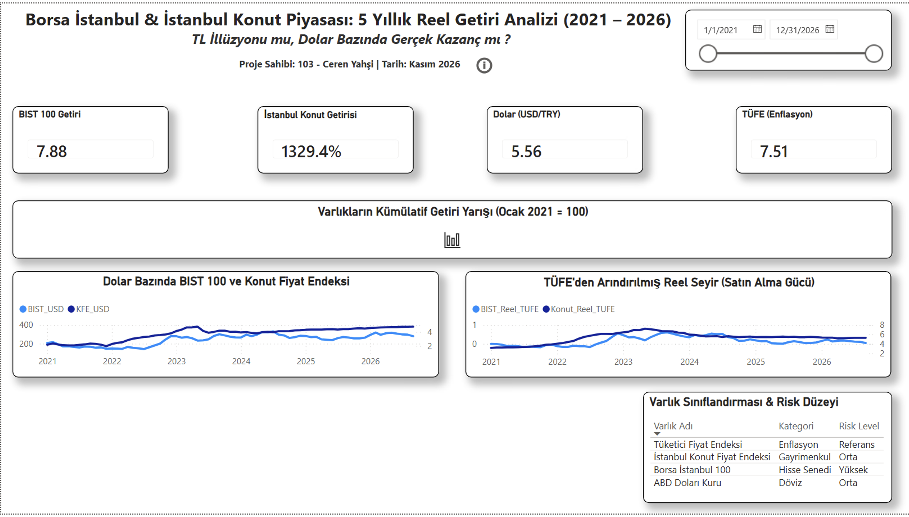

# BIST 100 Nominal vs. Reel (USD Bazlı) Getiri ve Risk Analizi (2021–2026)

[](https://www.python.org/)
[](https://pandas.pydata.org/)
[](https://powerbi.microsoft.com/)
[](LICENSE)

- **Proje Kodu - Proje Sahibi:** 103 - Ceren Yahşi
- **Eğitim Programı:** SoftITo — Veri Analitiği 26
- **Analiz Dönemi:** 04 Ocak 2021 – 23 Ekim 2026 (1.448 Ortak İşlem Günü)

---


## Power BI Dashboard Önizlemesi



---

## 1. Proje Özeti ve Araştırma Hipotezi

Yüksek enflasyon ve döviz kuru oynaklığının yaşandığı dönemlerde finansal varlıkların nominal (TL bazlı) getirileri yatırımcılarda **para yanılsaması (money illusion)** yaratabilmektedir. Bu çalışma, Borsa İstanbul BIST 100 endeksinin 2021–2026 dönemindeki performansını hem **TL (nominal)** hem de **USD (reel/döviz bazlı)** perspektiften karşılaştırarak kur etkisinin borsa kazançlarını ne ölçüde erittiğini ampirik olarak test etmektedir.

* **Araştırma Hipotezi ($H_1$):** *BIST 100 endeksi 2021–2026 döneminde TL bazında yüksek nominal artış sergilese bile, USD/TRY kurundaki yükseliş nedeniyle döviz bazlı reel getirisi sınırlı kalmış ve yıllık bazda çoğunlukla negatif reel getiri üretmiştir.*

---

## 2. Temel Bulgular ve Hipotez Test Sonucu

1. **Nominal vs. Reel Uçurum:** 4 Ocak 2021'de **1.495,40 puan** olan BIST 100 endeksi, 23 Ekim 2026 itibarıyla **11.117,00 puana** ulaşarak nominal olarak **+%643,41** getiri sağlamıştır. Ancak aynı dönemde USD/TRY kurundaki artış nedeniyle endeksin dolar bazlı değeri **$201,17** seviyesinden **$223,73** seviyesine yükselmiş; yaklaşık 6 yıllık kümülatif reel getiri yalnızca **+%11,21** olarak gerçekleşmiştir.
2. **Yıllık Kırılım ve Satın Alma Gücü Erozyonu:** İncelenen 6 takvim yılının **4 tanesinde** (2021, 2023, 2025 ve 2026) BIST 100 dolar bazında yatırımcısına reel kayıp yaşatmıştır. Yalnızca 2022 (+%104,20) ve 2024 (+%7,47) yıllarında pozitif USD getirisi elde edilmiştir.
3. **Kur Kaynaklı Ek Risk (Volatilite):** Yıllıklandırılmış oynaklık (252 işlem günü bazında) TL cinsinden **%28,09** iken, döviz kuru dalgalanmasının eklenmesiyle USD bazlı oynaklık **%32,00** seviyesine yükselmiştir.

### Genel Performans ve Risk Karşılaştırması (2021–2026)

| Metrik | TL Cinsinden (Nominal) | USD Cinsinden (Reel) |
| :--- | :---: | :---: |
| **Başlangıç Değeri (04.01.2021)** | 1.495,40 TL | $201,17 |
| **Bitiş Değeri (23.10.2026)** | 11.117,00 TL | $223,73 |
| **Kümülatif Toplam Getiri (%)** | **+%643,41** | **+%11,21** |
| **Yıllıklandırılmış Volatilite (Risk)** | %28,09 | %32,00 |

### Yıllara Göre Nominal (TL) ve Reel (USD) Getiri Performansı

| Yıl | TL Bazlı Getiri (%) | USD Bazlı Getiri (%) | Değerlendirme |
| :--- | :---: | :---: | :--- |
| **2021** | +%24,23 | **-%30,52** | Kur şoku nedeniyle ciddi reel kayıp |
| **2022** | +%185,94 | **+%104,20** | Güçlü enflasyon rallisi ve reel kazanç |
| **2023** | +%31,96 | **-%16,66** | Nominal artışa rağmen reel değer kaybı |
| **2024** | +%28,94 | **+%7,47** | Sınırlı reel pozitif getiri |
| **2025** | +%13,05 | **-%6,89** | Enflasyon ve kur baskısı altında reel kayıp |
| **2026** *(Ekim)* | -%3,32 | **-%16,34** | Hem TL hem USD bazında negatif getiri |
```
